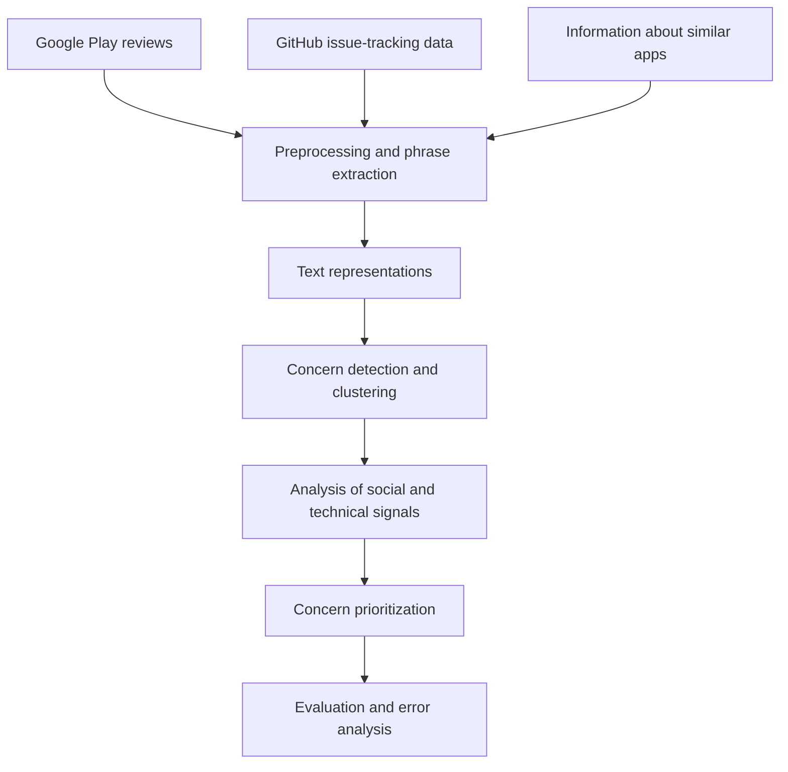

# Detecting and Prioritizing User Concerns in Mobile Apps

**MSc thesis · Computer Engineering (Algorithms & Computation) · Sharif University of Technology · October 2025**

**Author:** Shima Rezai  
**Supervisor:** Dr. Abbas Heydarnoori

## Overview

Mobile-app developers receive large volumes of feedback in app-store reviews, while issue-tracking systems contain complementary technical information. This thesis investigates how these sources can be combined to identify, group, and prioritize user concerns—such as reported bugs, feature requests, and suggestions for improvement.

The central idea is to move beyond treating each review in isolation: combine user-facing feedback with software-development evidence and information about similar applications to provide a more structured view of the concerns that may matter most.

## Research questions

- How can user concerns be identified from large collections of app reviews?
- Can app-store reviews be enriched with issue-tracking information from GitHub?
- How can text representations and clustering be used to group related concerns?
- Which social and technical signals can help prioritize concern clusters?

## Data and methodology

The thesis reports using the DATAR dataset covering **1,363 mobile applications**, with user reviews from Google Play and technical information from GitHub issue-tracking repositories. Data from similar applications is also used to enrich the analysis.

The proposed workflow includes:

1. **Multi-source data collection** — combine app reviews with software issue-tracking data.
2. **Text preprocessing** — clean and normalize text, prepare terms and phrases, and extract salient word pairs.
3. **Text representation** — use language/text representations, including FastText-based representations, to support semantic analysis.
4. **Concern discovery** — apply machine-learning and clustering methods to group related user concerns and label clusters.
5. **Prioritization** — combine social signals from user feedback with technical and historical software signals.
6. **Evaluation** — compare approaches using classification metrics, including precision, recall, F1-score, and accuracy, with additional analyses of clusters and features.

## Research workflow

The diagram below summarizes the high-level workflow described in the thesis. It is a conceptual overview, not executable code.

## Reported result

The thesis reports that a **Random Forest model achieved 0.7906 accuracy** in the evaluated concern-identification/prediction setting. The thesis also reports an F1-score of approximately **0.83** for the corresponding evaluated result.

These are the results reported in the thesis, not a fresh reproduction run from this repository. They should be interpreted in the context of the thesis's particular data, labels, splits, and evaluation design.

## Why this work matters

Prioritizing user concerns is a software-maintenance and decision-support problem as well as a text-mining task. Combining user-facing feedback with technical issue-tracking information can help developers build a more complete picture of reported problems and potential improvements.

## Technologies and methods

- **NLP / text mining:** text preprocessing, phrase extraction, text representations
- **Machine learning:** Random Forest and other baseline/classification approaches
- **Unsupervised analysis:** clustering and cluster interpretation
- **Evaluation:** precision, recall, F1-score, accuracy, feature and error analysis
- **Data sources:** Google Play reviews, GitHub issue-tracking data, DATAR

## Repository status

This repository currently provides an English overview of the MSc thesis. The original thesis is written in Persian. The research code, detailed experiment configurations, and datasets have **not yet been added** to this public repository.

Code and data will only be added after checking that they are shareable and removing any restricted, personal, or licensed material. Until then, this README should be treated as a project summary—not a claim that the full experiment is reproducible from this repository.

## Planned additions

- An expanded English research summary covering the precise pipeline and evaluation protocol
- Selected results tables, where permitted
- Cleaned, shareable implementation code and configuration files, if available
- Reproduction instructions and documented limitations

## Citation

Rezai, Shima. *Detecting and Prioritizing User Concerns in Mobile Apps*. MSc thesis, Department of Computer Engineering, Sharif University of Technology, October 2025. Supervisor: Dr. Abbas Heydarnoori.
